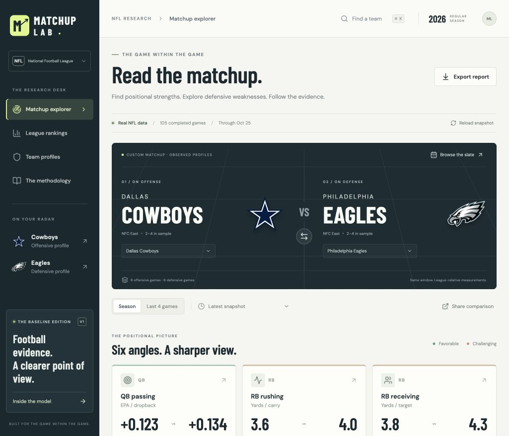

# NFL Matchup Lab

A football research workbench for finding positional strengths, weaknesses and matchup conditions. Built with React, TypeScript and Vite for a GitHub → StackBlitz workflow.

V1 starts with real, bundled public NFL data so the application works immediately without credentials or a backend. It compares offensive production with defensive concessions and makes sample size and data age visible. It is a descriptive baseline for the larger opponent-adjusted projection model, rather than a finished betting model.

- **Matchup explorer:** compare both offensive directions, inspect positional evidence, and open player usage shares.
- **League rankings:** compare all 32 teams, sort by a selected performance metric, and export all 32 measurements per side.
- **Team profiles:** inspect all measurements, observed strengths, tendencies and interactive game-by-game trends.
- **Methodology:** review definitions, sources, sample thresholds and model limits.



## Run locally

Use Node.js 22 or later.

```sh
npm ci
npm run dev
```

Open the local address printed by Vite. The initial view reads the bundled snapshot; it does not download a full play-by-play season in the browser. No `.env` file is required.

## Bring it to GitHub and StackBlitz

1. Create a GitHub repository and upload the contents of this folder, including `package-lock.json` and the bundled `public/data` files.
2. Import that repository into StackBlitz as a Vite/Node project.
3. Run `npm install` and `npm run dev` if the development server does not start automatically.

The project runs without Supabase, ESPN credentials or paid feeds. Refreshing the research data is a separate task from starting the interface. A private GitHub repository controls access to the source repository; it does not automatically add authentication to a deployed copy of the app. If the app later needs authenticated sharing, add that before deploying it beyond your intended audience.

## Refresh the snapshot

The refresh script fetches public source files, aggregates them into compact team/game records and writes a replacement snapshot.

```sh
npm run data:refresh -- --season 2026
npm test
npm run build
```

Run refresh from a terminal with internet access. Review the printed coverage summary and changed data files before committing. An upstream outage should not require replacing the last usable bundled snapshot. Refresh is manual in V1; opening the site is not a data refresh.

See [data sources and refresh details](docs/data-sources.md) for coverage, attribution and source timing.

## What V1 means

The application separates **offensive strength**, **defensive strength** and **offensive matchup conditions**. A defense can be strong overall while allowing a particular receiving role favorable conditions. A favorable positional comparison does not guarantee that a low-volume player will produce a large total.

The current implementation is a transparent profile comparison. Its matchup indications are research signals, not calibrated probabilities, player projections or verified betting edges. The next modeling step is to establish whether those signals improve a simple historical baseline on held-out games.

Read the [methodology](docs/methodology.md) for denominators, percentile direction, shrinkage and the exact interpretation of matchup indicators. The [architecture and next steps](docs/architecture.md) describe where opponent adjustment, opportunity allocation and saved forecasts belong.

## Checks

```sh
npm run typecheck
npm test
npm run build
```

The test suite checks statistical behavior and cutoff handling. The GitHub workflow runs the same checks on pushes and pull requests. `npm run preview` serves a production build locally after `npm run build`.

## Project layout

```text
src/                 Interface and pure TypeScript research calculations
public/data/         Compact bundled research snapshot
scripts/             Manual public-data refresh pipeline
tests/               Model invariants and coverage checks
docs/                Methodology, sources and extension plan
.github/workflows/   Build, type and test checks
```

## Attribution

Research data is provided by [nflverse](https://github.com/nflverse/nflverse-data) and its upstream sources. The bundled snapshot transforms that source into team/game aggregates. Team marks and any externally hosted photographs remain the property of their respective owners; this project is unaffiliated with the NFL or its clubs. Source code is MIT licensed; third-party data and assets retain their own terms. See [data attribution](docs/data-sources.md).
